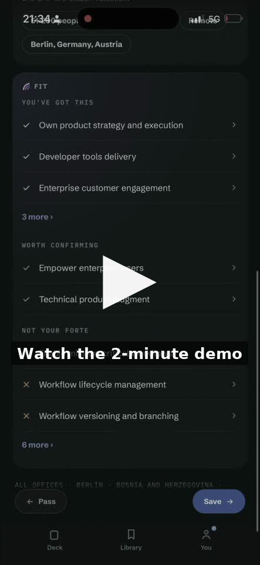
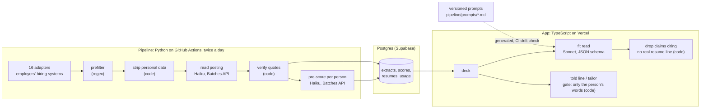

# docket

**A job-search app that reads each posting against your resume, shows you requirement by requirement
what you can prove, and helps you tailor and apply yourself.** I built it on my own, as product
owner and engineer, with AI coding agents writing most of the code under rules, tests and checks I
set up.

I'm Edoardo Guerrini, an AI product manager in Zürich. At a Big Four firm I take enterprise AI
products from discovery to production. docket is where I do the whole job myself: decide what to
build, measure model quality before shipping, and make the app claim only what it can show.

**At a glance** (private repository, 16 September to 22 October 2026):
**2,238 commits in five weeks**, most written by coding agents · **245 test files** across Python,
Playwright and TypeScript · **884 recorded decisions**, each with its reasoning and how to reverse it ·
**16 hiring-system adapters** · a **75-mark golden set** I labelled by hand to measure model quality.

<a href="https://eguerrini.github.io/docket/"></a>

**[Watch the two-minute demo](https://eguerrini.github.io/docket/)**: swipe through jobs, see what
your resume proves for each requirement, answer a question where it falls short, get a tailored
resume, and apply on the employer's own page.

The application code is private. This repository has:

- this page: how docket works, how its AI is kept grounded, and what I measured;
- [`examples/`](examples/): three small runnable extracts with synthetic data (the quote checks, the
  eval harness, and the prompt-drift check);
- [`workflow/`](workflow/): how I build with coding agents, including the actual instruction files,
  skills and safety hook.

## What it does

1. **A deck of jobs.** docket reads open postings from employers' own hiring systems and deals the
   ones that fit you as cards. You swipe to save or pass, and a note on why teaches it your
   preferences.
2. **A fit read for every card.** For each requirement, it says whether your resume shows it, whether
   it's worth confirming with you, or whether it's not your strength. Every claim comes with the
   posting's own words.
3. **Tailoring by asking, not inventing.** Where your resume falls short, docket asks you a short
   question that quotes the posting. You answer in a sentence, and docket turns your answer into a
   resume line, using only what you said.
4. **You apply.** The tailored resume renders as PDF or Word on the phone, in one of four templates,
   and you apply on the employer's page. docket never applies or sends anything on your behalf.

It is in private testing: I use it for my own search, and the first testers join by invitation.
Postings come from employers in Switzerland and across Europe.

## Architecture

Two programs share one Postgres database (Supabase) and never call each other directly.

- **The pipeline** (Python on GitHub Actions, twice a day) collects postings from 16 kinds of
  employer hiring systems through one adapter interface, `fetch(slug) -> list[Job]`. Every request
  goes through a single fetch function that checks robots.txt and identifies itself as docket's bot.
  It reads only public job feeds from employers whose terms allow it. A regex prefilter decides what
  reaches a model; personal data is stripped before any model sees the text; batched model calls
  turn each posting into a structured extract and pre-score it for each person.
- **The app** (TypeScript, TanStack Start on Vercel) is the deck, the fit read, the resume, the
  questions and the tailoring.
- **Prompts** are versioned files. Where the app and the pipeline run the same prompt, a script
  generates the app's copy and CI fails if they drift.

docket keeps no posting's full text after reading it. It stores the extract: the facts, each
requirement with its verbatim line (at most 25 words), short summaries, tags, the link, and a hash of
the original text.



## Choosing models: quality first, then latency and cost

Cheap, high-volume work runs batched on the smallest model. The reasoning a person reads on a card
runs on a mid-sized model. Rare, heavy reads use the largest. Every call is metered.

| Call | Model | How |
| --- | --- | --- |
| Read each posting into an extract | Haiku 4.5 | Message Batches API, on the schedule |
| Pre-score every eligible posting for every person | Haiku 4.5 | Batches on the schedule; live when one person's run is started |
| Fit read, requirement by requirement | Sonnet 5.5, low effort | live, structured output with a JSON schema |
| Read an uploaded CV; assessments; tailoring questions | Opus 5 | live, once per upload or request |

- **Batching** halves the cost of the scheduled work. A posting read cost about $0.013 batched.
- **Why Sonnet, not Haiku, for the fit read.** Before the run I set the bar: the newer Haiku 5.5
  would replace Sonnet if it scored 49 or more of 75 on both passes of the golden set, within three
  marks of Sonnet. It scored 48 and 47; Sonnet scored 52 and 54. The gap is close to the set's noise
  (about 4 to 5 marks), so the decision rests on the bar fixed in advance, not on significance.
  Sonnet costs about $0.021 a card against Haiku's $0.003, and it stays.
- **Latency.** When a new deal of cards lands, the app requests fit reads for the first ten in
  parallel, so the card you open is usually ready. Others are read when opened.
- **Spend control.** Every live call reserves its estimated cost before it runs, in one database
  transaction that locks a single settings row, so the app and the pipeline can never spend the same
  headroom. A reservation is refused above the global daily ceiling, the person's daily allowance, or
  a per-purpose cap. Batches are checked against the ceiling before they are submitted. Prices live in
  one table, and a check fails the build if the app's copy drifts from the pipeline's.

## Grounding: the model proposes, code verifies

- **Posting quotes are checked by code.** The model cites a posting line by number and code copies
  it. A line of up to 25 words is quoted whole; a longer one needs a span that appears in the line
  exactly. A quote that fails is dropped and counted with its reason, never repaired.
- **Fit claims must cite a resume line that exists.** A claim that the resume shows something, or
  that it's worth confirming, must point at a real line of the person's resume, or code drops it.
  Whether that line really supports the claim is the model's judgement, and the golden set measures
  it.
- **Nothing the person didn't say.** When a person answers a question and a model turns the answer
  into a resume line, code refuses the line unless every number is one they gave and every word is
  theirs, the requirement's, or a joining word. A dropped negation is refused too. A refused line
  falls back to the person's own words.
- **The tailor doesn't reword your bullets.** In a blind pairwise test, an LLM judge compared
  rewritten bullets with the originals (49 pairs, each judged twice, with the order swapped). The
  rewrites lost 26 to 38, while rewritten summaries won 23 to 11. So the shipped tailor rewrites the
  summary, selects and orders, and discards any bullet text a model returns. The judge counted only
  after calibration against my own ratings: Cohen's kappa 0.43 (standard error 0.11) on 47 held-out
  pairs.
- **Personal data in postings** (emails, phone numbers, personal links, contact names) is stripped
  by code before a model reads the posting, and a read whose output still contains any is refused.

Runnable versions of the first three checks: [`examples/grounding`](examples/grounding/).

## Evals

- **A golden set, hand-labelled by me:** 75 marks over real postings and fictional resumes. A mark
  says which verdicts are acceptable for one requirement. There is one rater, so the set measures
  agreement with my judgement, not with a panel's.
- **Noise-aware comparisons.** A change runs as paired, repeated passes, and the verdict uses a
  bootstrap interval over the marks and then each arm's passes (four passes an arm). A change ships
  only if the interval excludes zero, never on a single pass. On this set a change has to move about
  4 to 5 marks to stand out; run-to-run variation alone is about 2.

Changes the evals stopped:

| Change tried | Result | Outcome |
| --- | --- | --- |
| Haiku 5.5 instead of Sonnet 5.5 for the fit read | 48 and 47 of 75, against 52 and 54 | Not shipped |
| Medium reasoning effort instead of low | mean 54.75 against 57.5 | Not shipped: no gain beyond the noise, and slower |
| A looser "parts" rule in the fit prompt | mean 53.5 against 57.5, though higher on two other sets | Not shipped: the golden set ranks first |
| A fit prompt where the job title decides | +1.00 marks, interval −2.50 to +4.75 | Inside the noise, not shipped |
| Rewritten resume bullets | lost 26 to 38 in the blind test | Removed from the product |
| A new tailor writer the judge preferred | 5.2 refused lines per 100, against a limit of 3 | Not shipped |

The first row ran on 8 October. Later that day, reviewing marks where the model disagreed with me, I
agreed with it on five and relabelled them, which
moved Sonnet's baseline to a mean of 57.5 over four runs; the later rows compare against that.

Evals run before a prompt or model change ships, and each result is recorded in the decision log. CI
runs the harness's own self-tests on planted inputs, so a broken harness fails the build; the evals
themselves don't gate deploys.

A reduced, runnable version of the harness: [`examples/golden-set-eval`](examples/golden-set-eval/).

## Privacy and security

- **Each person sees only their own data, and it's tested.** A cross-account suite signs in as two
  test accounts and checks, route by route, that neither can read or change the other's rows, and
  that a missing or bad token gets a 401.
- **Network access is allow-listed in CI.** A check fails the build if any code calls the network
  outside the one client file per service the project uses, or the single fetch function for outside
  pages.
- **No posting text kept**, and personal data stripped before any model read (above).
- **Secret scanning:** gitleaks scans the full git history on every push to the main branch.
- **Export and delete:** a person can download everything stored about them and delete their
  account; a test proves both against a row in every personal table.
- **The coding agents are guarded too:** see the [safety hook](workflow/WORKFLOW.md#7-safety-rails-for-an-agent-with-a-shell).

## How it's built

I wrote the specs, made the product decisions, labelled the evals and tested every feature on a
phone. Coding agents built from tickets, each in its own branch, and the only way an agent session
can reach the main branch is a landing script that runs the checks, collects live evidence and passes a
definition-of-done gate. [`workflow/WORKFLOW.md`](workflow/WORKFLOW.md) explains the process and why
each rule exists; the agent instruction files, skills and the safety hook are copied there.

Prompts live as 23 versioned files, and the decision log records for each entry what was decided,
why, what was rejected and how to reverse it.

## Running the examples

Python 3.8 or later, standard library only.

```
cd examples/golden-set-eval && python3 golden_eval.py data/marks.json data/control.json data/candidate.json
cd examples/prompt-drift    && python3 emit.py --check
cd examples/grounding       && python3 demo.py
python3 -m unittest discover -s examples/grounding -t examples/grounding    # and the same for the others
```

CI runs all of them: [`.github/workflows/examples.yml`](.github/workflows/examples.yml).

## License

The code in `examples/` and `workflow/` is MIT-licensed; the write-up and the demo video are shared for viewing. See [LICENSE](LICENSE).
